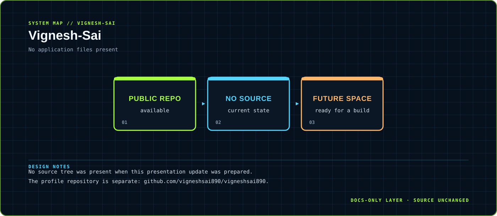

# Vignesh-Sai

> A public sandbox reserved for future experiments and presentation work.

This repository is currently empty, so the visual layer documents its state without inventing an application architecture.

`No runtime declared` &nbsp;·&nbsp; `Future workspace`

## `01 / SYSTEM CARD`

- **Primary boundary:** `No application files present`
- **Documentation stance:** architecture and presentation only; application source is intentionally untouched.
- **Visual language:** Y2K terminal grid, brutalist labels, maximalist contrast, readable static SVG fallback.

## `02 / ARCHITECTURE`

The map above is a compact view of the repository's visible runtime boundary. It is designed to answer three questions quickly: where input enters, where policy or domain logic lives, and where external side effects leave the system.

## `03 / DESIGN NOTES`

- No source tree was present when this presentation update was prepared.
- The profile repository is separate: github.com/vigneshsai890/vigneshsai890.

This upgrade adds documentation assets only. It does not change source files, dependency manifests, tests, workflows or runtime configuration.

## `04 / EXISTING PROJECT DOCUMENTATION`

No README content was present before this upgrade. This page intentionally documents the repository's current state without inventing implementation details.

